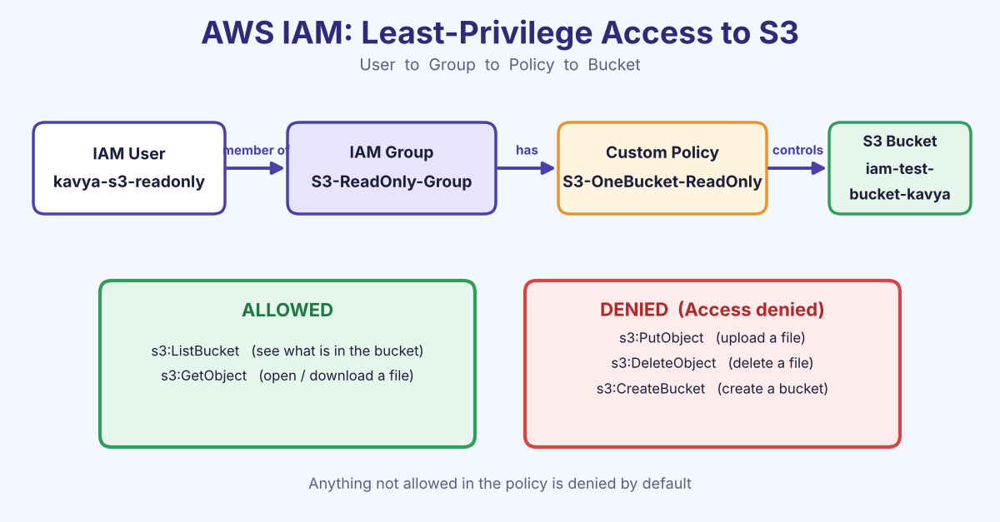
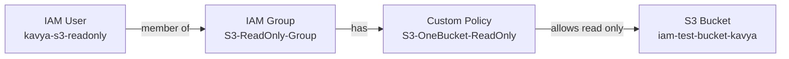
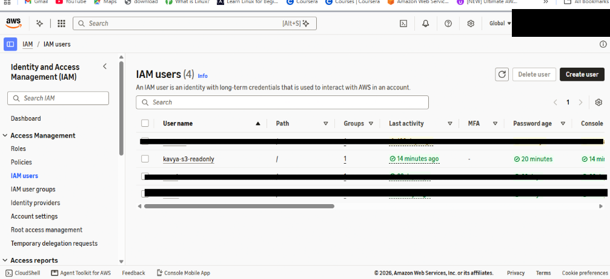
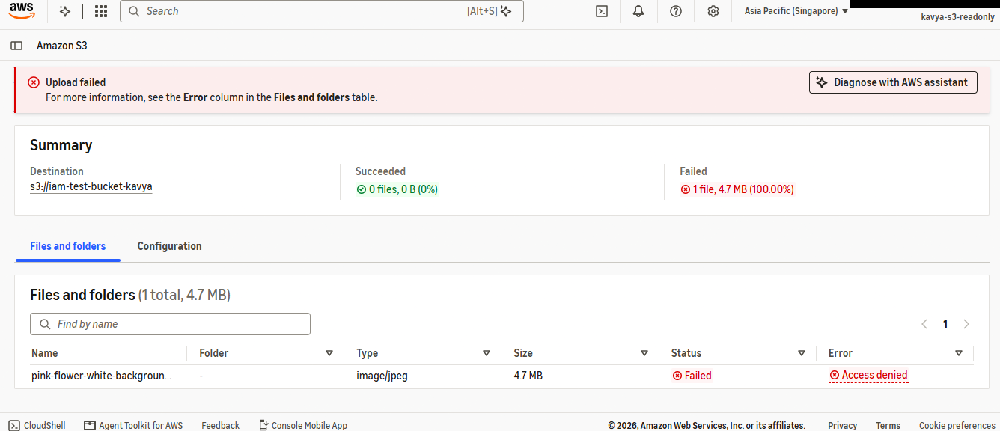
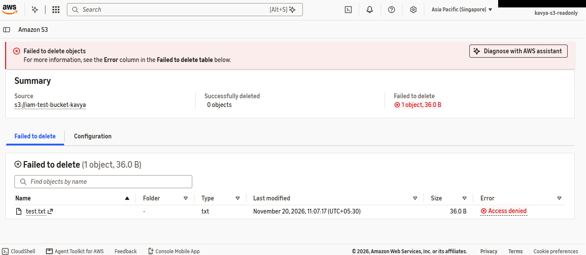
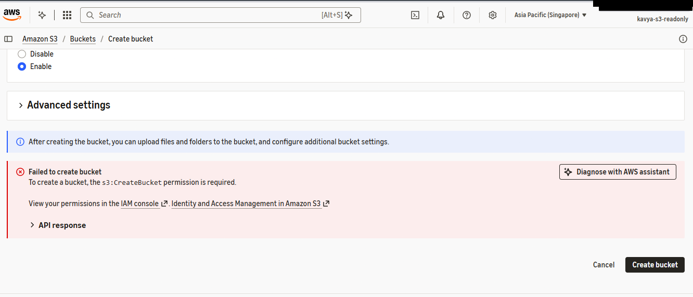

# Amazon IAM: Least-Privilege Access with Users, Groups and Policies

A hands-on cloud project where I create an **IAM user** who can only *view* one S3 bucket, using an IAM **group** and a **custom policy**, and then prove that uploading, deleting and creating buckets are blocked.

This project is part of my cloud and DevOps learning series.

## What I built

- An S3 bucket with a test file (`test.txt`)
- An IAM group, `S3-ReadOnly-Group`, first with the AWS managed policy **AmazonS3ReadOnlyAccess**
- An IAM user, `kavya-s3-readonly`, added to that group, with console access
- A **custom policy**, `S3-OneBucket-ReadOnly`, that allows read-only access to a single bucket
- Tests that show what the user can and cannot do

## Architecture





## Steps

### 1. Create an S3 bucket
1. Open **S3** and click **Create bucket**
2. Bucket name: `iam-test-bucket-kavya`
3. Keep **Block all public access ON**. This project does not need public access.
4. Click **Create bucket**
5. Open the bucket, click **Upload**, add a small file named `test.txt`, and upload it

### 2. Create a group with a managed policy
1. Go to **IAM**, then **User groups**, then **Create group**
2. Group name: `S3-ReadOnly-Group`
3. Attach the policy **AmazonS3ReadOnlyAccess**
4. Click **Create user group**

### 3. Create an IAM user
1. Go to **IAM**, then **Users**, then **Create user**
2. User name: `kavya-s3-readonly`
3. Tick **Provide user access to the AWS Management Console** and set a custom password (use a strong password, and never post it)
4. On the permissions page choose **Add user to group** and select `S3-ReadOnly-Group`
5. Click **Create user** and copy the **console sign-in URL**

### 4. Test the permissions (first test)
1. Open a **private/incognito window** and paste the sign-in URL
2. Sign in as `kavya-s3-readonly`
3. Open **S3**. The bucket and `test.txt` are visible
4. Try to **upload** a file: **Access denied**
5. Try to **delete** `test.txt`: **Access denied**

### 5. Write a custom policy
1. In the main account, go to **IAM**, then **Policies**, then **Create policy**
2. Open the **JSON** tab and add this policy (use your own bucket name):

```json
{
  "Version": "2012-10-17",
  "Statement": [
    {
      "Effect": "Allow",
      "Action": ["s3:ListBucket", "s3:GetObject"],
      "Resource": [
        "arn:aws:s3:::iam-test-bucket-kavya",
        "arn:aws:s3:::iam-test-bucket-kavya/*"
      ]
    }
  ]
}
```

3. Policy name: `S3-OneBucket-ReadOnly`, then click **Create policy**

### 6. Attach the custom policy to the group
1. Go to **IAM**, then **User groups**, then `S3-ReadOnly-Group`, then the **Permissions** tab
2. Select **AmazonS3ReadOnlyAccess** and click **Remove**
3. Click **Add permissions**, then **Attach policies**, and choose `S3-OneBucket-ReadOnly`

### 7. Test the permissions again
1. In the incognito window, refresh or sign in again as `kavya-s3-readonly`
2. The S3 bucket list page shows **Access denied**, because the policy only allows access to one bucket and not the list of all buckets
3. Open the bucket directly by its name or link and `test.txt` is visible
4. Try to **upload** a file: **Access denied**
5. Try to **delete** `test.txt`: **Access denied**
6. Try to **create a bucket**: **Access denied**

### 8. Clean up
1. In the main account, delete the file and the bucket
2. Delete the IAM user, the group, and the custom policy

## Results

**The IAM user `kavya-s3-readonly` created and added to the group**



**Upload blocked: Access denied**



**Delete blocked: Access denied**



**Create bucket blocked: Access denied (`s3:CreateBucket` is required)**



## Notes and what I learned

- **Least privilege:** give a user only the permissions they need and nothing more.
- Permissions are **denied by default**. Anything not allowed in a policy is blocked.
- Permissions from several policies **add together**, so I removed the broad managed policy before testing the custom one.
- Attaching policies to a **group** is easier to manage than attaching them to each user.
- A custom policy can limit access to **one bucket**. Because it does not allow listing all buckets, the bucket list page is denied, and the bucket has to be opened directly.
- In my first run I used the same public settings as my earlier S3 projects. This project does not need public access, so I recommend leaving Block Public Access on.
- Never share passwords, access keys or your account ID in screenshots or posts.

## Next steps

- Create an admin IAM user for daily use and turn on **MFA** for the root account
- Try an **IAM role** that a service assumes, instead of a user
- Automate the setup with the AWS CLI or Terraform

## Tools

AWS Console, AWS IAM, Amazon S3
